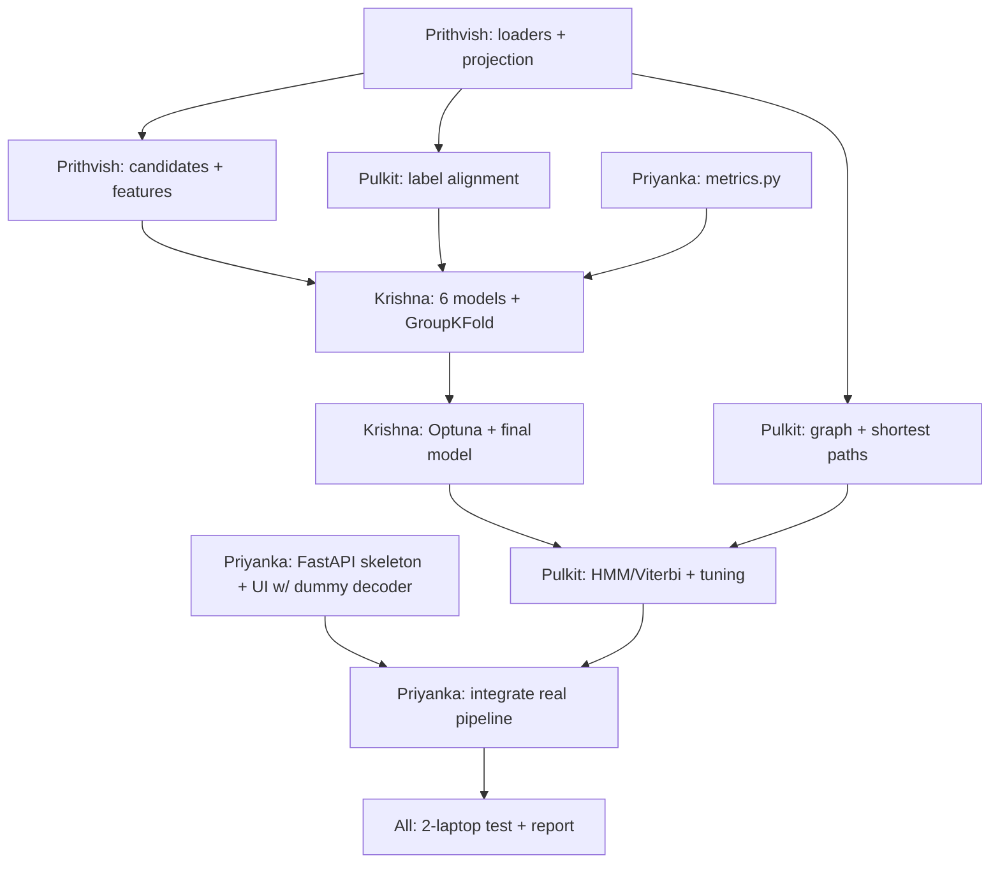

# PathSnap – Implementation Roadmap, Team Plan & Panel Strategy

Status: **draft for team review. No code has been written yet.** Real dataset numbers are in [STAGE1_DATASET_AUDIT.md](STAGE1_DATASET_AUDIT.md).

---

## 0. What was read and checked

| Source | Status |
|---|---|
| Main Guidelines.pdf | Read (2 pp) |
| Dataset Exploration.pdf | Read (4 pp) |
| Models and Training Guidelines.pdf | Read (6 pp) |
| Deliverables.pdf (report + submission) | Read (7 pp) |
| Assessment and Plagiarism Policy.pdf | Read (3 pp) |
| Student folder.zip | Fully audited (90 trips, 360 files) |
| YouTube `ChtumoDfZXI` | **Not watched.** I can only confirm its title, *"Map Matching @ Uber"* by Uber Engineering. I cannot view video content. **Please paste the transcript** (YouTube → "…" → *Show transcript*) and I will extract the techniques it uses. Until then nothing in this plan depends on it. |

Environment note: **this laptop has no Python installed.** Only the Microsoft Store stub exists. Install Python 3.11 before Stage 2 (see §9).

---

## 1. The problem in plain words

A car drove somewhere and recorded its position about once per second. Those positions are noisy. They drift 5–15 m sideways, sometimes jump 100 m, and sometimes go silent for minutes. We also get the street map for that area as a graph: **nodes** (points) joined by **arcs** (one-way street pieces; a two-way street is two arcs).

For every GPS point we must answer one question: **which arc was the car actually on?** The answers must chain together into a drivable route.

How the four files relate:

```
.track row i  ──(nearby?)──►  candidate arcs  ──(arc_id = row in .arcs)──►  (from_node, to_node)  ──►  .nodes rows (lon,lat)
                                                                      ▲
.route  = ordered list of arc_ids the car really drove  ──────────────┘   (no per-GPS-point label!)
```

We solve it in two layers:

1. **ML classifier.** For each (GPS point, candidate arc) pair it predicts *"is this the right arc?"*, using only local evidence: distance, heading match, speed and so on.
2. **HMM + Viterbi.** It takes those per-point probabilities and picks the single best *sequence* of arcs that is also connected in the road graph. This fixes the "jumped to the parallel street for 2 seconds" errors that a point-by-point classifier makes.

---

## 2. End-to-end architecture

```mermaid
flowchart LR
  subgraph L1["Laptop 1 – FastAPI (uvicorn 0.0.0.0:8000)"]
    A[Trip loader<br/>.track .nodes .arcs] --> B[Preprocess<br/>UTM projection, Δt, speed, heading, gap split]
    B --> C[Candidate generator<br/>STRtree, radius r + top-K]
    C --> D[Feature builder<br/>per (point, candidate)]
    D --> E[Tuned classifier<br/>P(correct arc)]
    E --> F[HMM + Viterbi<br/>emission = P, transition = graph path]
    F --> G[Route builder<br/>arc sequence → GeoJSON]
    G --> H[Server-side evaluator<br/>reads .route privately]
  end
  subgraph L2["Laptop 2 – UI (static HTML + Leaflet)"]
    U1[10 trip buttons] -->|GET /api/predict/{id}| L1
    L1 -->|JSON: GPS, predicted route, metrics<br/>NO reference route| U2[Map + metrics panel]
  end
```

**API contract (draft):**

| Endpoint | Returns |
|---|---|
| `GET /api/health` | model version, loaded assets |
| `GET /api/trips` | the trip IDs found in the configured evaluation folder (read from disk, **not hard-coded**) |
| `POST /api/predict/{trip_id}` | `gps_points`, `classifier_route`, `hmm_route` (GeoJSON), `metrics` {top1_acc_hmm, top1_acc_clf, candidate_miss_rate, route_continuity, route_f1, invalid_transitions, n_unmatched, runtime_ms} |

The reference route is **never** sent to the UI. Only numbers computed from it leave the server. The guidelines say ground truth "must never be exposed to the prediction model or UI".

---

## 3. Technical strategy, stage by stage

### 3.1 Preprocessing (Stage 3)
- Pick a per-trip UTM zone from the trip centroid (`pyproj`) and project nodes and GPS into metres. We justify this as follows: trips span about 6–3,000 km², and UTM distortion is under 0.1 % at that scale.
- Derive Δt, step distance, speed, heading (from a smoothed ±1 neighbour), and turn rate.
- **Segment splitting:** start a new segment when Δt > 60 s or the jump is > 500 m. These thresholds get tuned. Points are flagged, never deleted.
- **Label alignment (train and student-test only):** a monotonic DP assigns each GPS point to a route arc while keeping route order (cost = point-to-arc distance). If the distance is > 50 m, the label is `UNMATCHED`. The alignment script logs coverage per trip.

### 3.2 Candidate generation (Stage 4)
- Build a `shapely.STRtree` over the projected arc segments for each trip.
- Query radius `r`, then keep the K nearest. Sweep r ∈ {25, 50, 75, 100 m} and K ∈ {4, 8, 12, 16}.
- **Candidate Miss Rate** = share of labelled points whose true arc is not among the candidates. Report it per trip and overall, and pick (r, K) on **train only**.
- Keep `candidate_id → arc_id` in every table (columns `trip_id, obs_idx, cand_rank, arc_id`).

### 3.3 Features (per point–candidate row)
| Feature | Why |
|---|---|
| `perp_dist_m`, `dist_rank`, `dist_minus_min` | Closer is more likely, but relative closeness matters more than absolute |
| `heading_diff_deg` (movement vs arc bearing, 0–180) | **The only feature that separates an arc from its reverse twin** |
| `speed_mps`, `heading_reliable` (speed > 2 m/s) | Heading is meaningless when stopped |
| `prev_dist`, `next_dist` (same arc, neighbouring points) | Temporal consistency without leaking labels |
| `arc_len_m`, `arc_out_degree`, `is_oneway` | Road-structure context |
| `proj_t` (position along arc 0–1), `n_candidates` | Ambiguity level |
| **Excluded:** raw lon/lat, arc_id, node_id | Location-specific. They would memorise cities and not generalise |

Every feature is computable at inference time from `.track`, `.nodes` and `.arcs` alone.

### 3.4 Models (Stage 5–6)
Task: binary classification on point–candidate rows, roughly 2 M rows with about a 1:8 positive ratio. Validation: **GroupKFold(5) by trip_id** over the 80 training trips. Student-test is used only for the final comparison.

| # | Model | Family | Why it's included |
|---|---|---|---|
| 1 | Logistic Regression (scaled, class_weight) | Linear | Baseline with well-calibrated probabilities |
| 2 | K-Nearest Neighbours (distance-weighted, subsampled) | Instance-based | Tests whether local similarity is enough. It's slow, which we report as a limitation |
| 3 | Random Forest | Bagging ensemble | Strong nonlinear baseline, robust to scale |
| 4 | HistGradientBoosting | Boosting | Fast on millions of rows and handles NaNs natively |
| 5 | LightGBM | Boosting | Expected best accuracy/speed. Main candidate for Optuna |
| 6 | MLP (sklearn, early stopping) | Neural net | The **only** model with real epoch-wise loss curves (the guidelines want those plots only where they genuinely exist) |

SVM is **skipped, with a stated reason:** kernel SVM is O(n²) on about 2 M rows, and it has no native probabilities, which Platt scaling would only partly fix.

Metrics for every model: accuracy, precision, recall, macro-F1, log-loss, confusion matrix (row level), **Top-1 accuracy** (argmax per observation), route continuity, training and inference time. **Primary selection metric: CV Top-1 accuracy, with log-loss as the tie-breaker.** Top-1 is what the HMM actually consumes, and log-loss measures how trustworthy the probabilities are.

### 3.5 Bayesian optimisation (Stage 7)
Optuna TPE with 50–100 trials. The objective is mean GroupKFold Top-1 (or negative log-loss) on train. Search space for LightGBM: `num_leaves 15–255 (log)`, `learning_rate 0.01–0.3 (log)`, `min_child_samples 10–500`, `feature_fraction 0.5–1`, `bagging_fraction 0.5–1`, `lambda_l1/l2 1e-8–10 (log)`, `n_estimators` with early stopping. We save the trial CSV, best params, study `.db`, wall-clock time and the refitted model. Then we compare untuned and tuned on CV and student-test.

### 3.6 HMM + Viterbi (Stage 8)
- **Hidden state** at time t = one candidate directed arc of observation t.
- **Emission** `log e_t(s) = α·log P_clf(s) + (1−α)·log N(dist; 0, σ)`, with α and σ tuned.
- **Transition** `p(s→s') ∝ exp(−|d_network(s,s') − d_gps(t,t+1)| / β)` (Newson–Krumm style). Here `d_network` is the directed shortest-path length from the projection on s to the projection on s', computed with Dijkstra and capped at a cutoff. Staying on the same arc is allowed when moving forward along it. No path, or a reverse move along the same arc, gives probability ε (log −30) instead of −∞.
- **Viterbi:** `δ_t(s') = log e_t(s') + max_s [δ_{t−1}(s) + log a(s,s')]`, with back-pointers. Complexity is O(T·K²) plus shortest-path calls, which are cached per arc pair.
- **Gaps and breaks:** decode each segment independently. A point with no candidates ends the segment.
- **Outputs** per observation: arc_id (or `null`). The route is the deduplicated arc sequence with short shortest-path fills between matched arcs.
- Tune (α, σ, β, cutoff) by grid or Optuna on train plus student-test only.
- **Evaluation** compares classifier-only (argmax) against HMM on: Top-1, route continuity (% of consecutive arc changes where `to(prev)==from(next)`), invalid-transition count, route-level arc precision/recall/F1 against `.route`, and runtime.

### 3.7 Visualisation
A `viz/folium_maps.py` module draws these layers: GPS points, network within the bounding box, candidates (optional), classifier route (red), HMM route (blue), reference route (green, **development partitions only**), and a LayerControl with a legend. EDA plots use matplotlib.

---

## 4. Ambiguities and inconsistencies to clear with organisers

1. **Evaluator data isn't in the archive.** How and when is it delivered? We'll make the API read a configurable folder (`PATHSNAP_EVAL_DIR`) and list whatever trips it finds.
2. **Per-observation labels don't exist.** We derive them by alignment. We should ask whether the official "Top-1 accuracy" uses a specific alignment. If not, we document ours.
3. **"Macro F1" on what?** The candidate rows are binary, so we report macro-F1 over {correct, incorrect}. Arc IDs can't be classes because they are per-trip.
4. **Can the UI show the reference route for evaluator trips?** The text says ground truth must never reach the UI. We will **not** show it, only the metrics.
5. **Partial reference routes** (trips 54, 33, and others): we treat far points as unlabelled and report that.
6. **Timeline:** Deliverables.pdf says "first phase evaluation before lunch break", which suggests a single event day. We need the exact time of the phase-1 check and what it expects.

---

## 5. Evaluation pitfalls (things that lose marks)

- Raw lat/lon as features. The model will look great in CV inside a city and collapse on new cities.
- Splitting rows instead of trips. Adjacent 1 Hz points are near-duplicates, so a row-level split inflates every metric.
- Reporting only row-level accuracy. About 88 % of rows are negatives, so "always no" scores 88 %. Lead with Top-1 instead.
- Fitting the scaler, imputer or thresholds on student-test.
- Hard-coding the 10 trip IDs, or caching predictions to disk and serving them. Every request must run the full pipeline, and the logs must show it.
- Showing the green reference route in the evaluator UI.
- Drawing loss curves for RF/LightGBM. LightGBM *does* log per-iteration validation loss, so that one is legitimate if we record it. RF and KNN have none.
- A firewall or college Wi-Fi client isolation blocking Laptop 2 from reaching Laptop 1 (§9).
- The repo exceeding 100 MB. Raw data stays out of git and gets downloaded or copied separately.

---

## 6. Team division

### 6.1 Workload re-balance (after seeing the data)
The audit shows two hidden heavy items: **label alignment** (no per-point labels exist) and **metrics shared by three people**. Prithvish's original list was the heaviest and Priyanka's backend can't start real work until a model exists. So:

- **Label alignment (GPS→route DP)** moves from Prithvish to **Pulkit**. It is a dynamic-programming sequence alignment, the same family as Viterbi, so it prepares Pulkit for the HMM and gives Pulkit work to do before the classifier exists.
- **Shared `metrics.py`** (Top-1, miss rate, continuity, route-F1) goes to **Priyanka**. The server-side evaluator needs it anyway, and Krishna and Pulkit import it, so everyone uses one definition.
- **Folium map module** goes to **Priyanka** (the UI reuses the same layers). Pulkit still produces the HMM-vs-classifier comparison maps *using* it.
- **Report assembly** is shared, and each owner writes their own sections.

### 6.2 Responsibility matrix (R = responsible, A = accountable/reviewer, C = consulted)

| Workstream | Prithvish | Krishna | Pulkit | Priyanka |
|---|---|---|---|---|
| Loaders, audit, EDA | **R/A** | C | C | C |
| Projection, preprocessing, gap split | **R/A** | C | C | |
| Candidate generation + miss rate | **R/A** | C | A | |
| Feature engineering | **R** | A | C | |
| Label alignment (GPS→route) | C | A | **R** | |
| Model training (6 models), CV | C | **R/A** | | |
| Bayesian optimisation | | **R/A** | C | |
| Calibration / emission interface | | **R** | A | |
| HMM, Viterbi, decoder tuning | C | C | **R/A** | |
| Shared metrics module | C | A | A | **R** |
| Folium / plotting module | C | | C | **R/A** |
| FastAPI backend + server eval | | C | C | **R/A** |
| Frontend + 2-laptop deploy | | | | **R/A** |
| Integration tests | R | R | R | **A** |
| Report §2.2 / §3–4 / §5–6 / §7 | R / – / – / – | – / R / – / – | – / – / R / – | – / – / C / R |

### 6.3 Interface contracts (agree on these on day 1)

| Artifact | Producer → consumer | Format |
|---|---|---|
| `load_trip(path) -> Trip` | Prithvish → all | dataclass: `gps (N×3)`, `nodes (M×2)`, `arcs (A×2)`, `route list or None`, `crs` |
| `candidates.parquet` | Prithvish → Krishna, Pulkit | `trip_id, obs_idx, cand_rank, arc_id, perp_dist_m, proj_t, …features` |
| `labels.parquet` | Pulkit → Krishna | `trip_id, obs_idx, true_arc_id (or -1 = unmatched)` |
| `model.predict_proba(features) -> p` | Krishna → Pulkit, Priyanka | saved `models/final/model.joblib` + `feature_list.json` |
| `decode(trip, cand_df, probs, params) -> DecodeResult` | Pulkit → Priyanka | `obs_arc (N, -1 for none)`, `route_arcs list`, `segments`, `runtime_ms` |
| `evaluate(trip, decode_result) -> dict` | Priyanka (`metrics.py`) → all | metric dict |

### 6.4 Dependency diagram



### 6.5 Milestones

Hours are given for a 1-day hackathon. If you have weeks, read each milestone as roughly 2–3 days.

| Milestone | Prithvish | Krishna | Pulkit | Priyanka | Done when |
|---|---|---|---|---|---|
| **M0 Setup** (0.5 h) | repo skeleton, `.gitignore` data | `requirements.txt`, venv | | GitHub repo + 4 branches, README stub | everyone runs `python -c "import pathsnap"` |
| **M1 First integration** (2–3 h) | `load_trip`, projection, STRtree candidates, miss-rate on train | baseline LogReg on a features stub; GroupKFold harness | label alignment v1 + coverage report | `metrics.py`; FastAPI skeleton `/trips` `/predict` returning nearest-arc dummy; UI shows GPS + dummy route | **One trip goes from UI → API → map end-to-end** (dummy model) |
| **M2 Experiments** (3 h) | full features, EDA plots, Folium EDA map | all 6 models, comparison table + plots | graph shortest paths, Viterbi v1 on LogReg probs | real classifier wired into API | comparison CSV exists, HMM runs on student-test |
| **M3 Optimise** (2 h) | review leakage, feature ablation | Optuna 50+ trials, tuned vs untuned | decoder param tuning, clf vs HMM table | final model + decoder in API, error handling, logs | tuned model saved; API returns real metrics |
| **M4 Deploy** (1.5 h) | — all four — | | | 2-laptop network test, firewall | the 10 trips (use student-test as a stand-in) run from Laptop 2 |
| **M5 Report + rehearsal** (2 h) | §2.2 | §3–4 | §5–6 | §7 + screenshots | PDF compiled; demo rehearsed twice |

**Review duties at each milestone:** Krishna reviews Prithvish's features for leakage. Pulkit reviews Krishna's probability outputs (calibration). Prithvish reviews Pulkit's arc-ID and graph usage. Pulkit reviews Priyanka's API response format. Everyone runs the integration test before merging to `main`.

### 6.6 Task tracker (seed – copy to GitHub Projects)

| ID | Owner | Task | Deliverable | Depends | Verify by | Status |
|---|---|---|---|---|---|---|
| T1 | Prithvish | Python audit reproducing STAGE1 numbers | `data/audit.py`, `results/eda/trip_audit.csv` | – | numbers match this doc | Not Started |
| T2 | Prithvish | UTM projection + preprocessing | `data/preprocess.py` | T1 | unit test: known distance | Not Started |
| T3 | Prithvish | STRtree candidates + miss-rate sweep | `candidates/generate.py`, `results/candidates/miss_rate.csv` | T2, T5 | miss-rate curve plotted | Not Started |
| T4 | Prithvish | Feature builder | `features/build.py`, `features.parquet` | T3 | no NaN surprises, schema test | Not Started |
| T5 | Pulkit | GPS→route label alignment | `labels/align.py`, `labels.parquet` | T2 | Folium overlay of 3 trips, coverage % | Not Started |
| T6 | Krishna | CV harness + 6 models | `models/train_all.py`, `results/models/*.csv` | T4, T5, T8 | comparison table | Not Started |
| T7 | Krishna | Optuna tuning | `models/optimise.py`, `results/optuna/` | T6 | trials CSV, best params | Not Started |
| T8 | Priyanka | Shared metrics | `eval/metrics.py` + tests | – | toy-example unit tests | Not Started |
| T9 | Pulkit | Graph + Viterbi + tuning | `hmm/` | T4, T7 | clf vs HMM table | Not Started |
| T10 | Priyanka | FastAPI + UI + deploy | `backend/`, `frontend/`, `docs/DEPLOY.md` | T8, T9 | 10-trip run from Laptop 2 | Not Started |
| T11 | Priyanka | Folium module | `viz/folium_maps.py` | T1 | maps open with legend | Not Started |
| T12 | All | Report + rehearsal | `report/PathSnap_Report.pdf` | all | every number traceable to a CSV | Not Started |

---

## 7. Repository structure

```
pathsnap/
├── README.md                 # ownership, setup, run, deploy, integration status
├── requirements.txt
├── .gitignore                # data/raw/, *.parquet over limit, .venv/
├── configs/                  # candidates.yaml, models.yaml, optuna.yaml, hmm.yaml (all seeds here)
├── data/                     # NOT committed: raw/ train/ student_test/ evaluator_test/
├── notebooks/                # 01_eda.ipynb, 02_candidates.ipynb, 03_models.ipynb, 04_hmm.ipynb
├── src/pathsnap/
│   ├── data/        loaders.py  audit.py  preprocess.py           (Prithvish)
│   ├── candidates/  generate.py  spatial_index.py                  (Prithvish)
│   ├── features/    build.py                                       (Prithvish)
│   ├── labels/      align.py                                       (Pulkit)
│   ├── models/      registry.py  train_all.py  optimise.py  calibrate.py  (Krishna)
│   ├── hmm/         graph.py  emission.py  transition.py  viterbi.py  decode.py  tune.py  (Pulkit)
│   ├── eval/        metrics.py  compare.py                         (Priyanka + all)
│   ├── viz/         folium_maps.py  plots.py                       (Priyanka + all)
│   └── pipeline.py  # single predict_trip() used by BOTH experiments and API
├── backend/         app.py  schemas.py  service.py  logging.conf   (Priyanka)
├── frontend/        index.html  app.js  style.css                  (Priyanka)
├── models/final/    model.joblib  feature_list.json  hmm_params.json
├── results/         eda/  candidates/  models/  optuna/  hmm/  maps/
├── tests/           test_loaders.py  test_metrics.py  test_viterbi.py  test_api.py
├── docs/            STAGE1_DATASET_AUDIT.md  PATHSNAP_ROADMAP.md  DEPLOY.md  API.md
└── report/
```

`pipeline.predict_trip()` is the **one** function that both the experiments and the API call. That is how training and inference stay consistent.

---

## 8. Integration risks

| Risk | Mitigation |
|---|---|
| Arc IDs mixed up across trips | Every table carries `trip_id`; tests assert that `arc_id < len(arcs)` |
| Label alignment wrong, so all metrics are wrong | Pulkit overlays aligned labels on Folium for 3 trips early (M1) |
| Feature mismatch between training and API | `feature_list.json` saved with the model; the API asserts the column order |
| Dijkstra too slow on 300k-arc networks | cap the search radius (e.g. 3× GPS step + 200 m), cache results, use scipy csgraph |
| 19k-point trip times out in the demo | measure the worst case early; add a progress log; set a UI timeout of 120 s |
| Network blocks Laptop 2 | phone hotspot as backup; Windows firewall rule; test on the actual venue Wi-Fi |
| Merge conflicts on `main` | small PRs, owner-only folders, a 15-min sync every 2 h |
| Someone can't explain someone else's module | cross-review pairs + the viva drill (§10) |

---

## 9. Two-laptop deployment (summary; full commands go in `docs/DEPLOY.md` at Stage 11)

```bash
# both laptops (Windows), once
winget install Python.Python.3.11
python -m venv .venv
.venv\Scripts\activate
pip install -r requirements.txt
```

```bash
# Laptop 1
ipconfig            # note IPv4, e.g. 192.168.43.10
netsh advfirewall firewall add rule name="PathSnap API" dir=in action=allow protocol=TCP localport=8000
uvicorn backend.app:app --host 0.0.0.0 --port 8000 --log-level info
```

```bash
# Laptop 2 (edit frontend/config.js -> API_BASE = "http://192.168.43.10:8000")
python -m http.server 5500 --directory frontend
```

Test from Laptop 2: `curl http://<L1-IP>:8000/api/health`. FastAPI must enable CORS for the Laptop-2 origin. The evaluator watches the uvicorn console on Laptop 1, as the guidelines require.

---

## 10. How to present as a team in front of the panel

### 10.1 Talk structure (about 12 min + Q&A). Follow the data through the pipeline, one speaker per stage.

| Time | Speaker | Content | Hand-off line |
|---|---|---|---|
| 0:00–1:00 | **Priyanka** (opens) | Problem in one sentence, architecture slide, "each of us owns one stage" | "Everything starts with the raw data – Prithvish." |
| 1:00–3:30 | **Prithvish** | 90 trips, *each with its own city network*; directed arcs; gaps/jumps; why UTM; candidate radius vs miss-rate curve; features and why no lat/lon | "So for every GPS point we now have ~K candidates with features. Krishna decides which is right." |
| 3:30–6:30 | **Krishna** | Group-by-trip CV; 6 models table; why Top-1 + log-loss; Optuna trials plot; tuned vs untuned | "A classifier still judges each point alone. Pulkit makes the route coherent." |
| 6:30–9:30 | **Pulkit** | Label alignment, HMM states/emission/transition, Viterbi recurrence on a 3-point toy example, classifier vs HMM table and a map where HMM fixes a parallel-street error **and one where it didn't help** | "Now let's see it run live across two laptops – Priyanka." |
| 9:30–12:00 | **Priyanka** | Live: panel picks a trip on Laptop 2 → show uvicorn log on Laptop 1 → map + metrics; explain that ground truth stays server-side | "We're happy to take questions – each of us will take our own area first." |

### 10.2 Rules for the room
- **Let the panel pick the trip.** It proves nothing is hard-coded.
- **The owner answers first**, and one teammate may add a single sentence. Never talk over each other. Hand off with "Pulkit built that – Pulkit, over to you."
- **Never claim something you didn't run.** Say: "We didn't test that. Our expectation would be X, because Y."
- Lead with honest limitations: partial reference routes, KNN too slow, cases where the HMM hurt. Panels reward this.
- Every number on a slide must be openable in `results/` on demand. Keep the folder open in a tab.
- Fallbacks: phone hotspot, and a second terminal with `curl` to show the API works even if the UI breaks. **No pre-recorded or cached results.** That would look like hard-coding.

### 10.3 Viva drill. Everyone must answer these, not just the owner.

| Area | Likely question | Owner |
|---|---|---|
| Data | Why not Euclidean on lat/lon? Why is a GPS row not a node row? How did you get per-point labels? | Prithvish / Pulkit |
| Features | Why no lat/lon features? How do you tell an arc from its reverse? | Prithvish |
| Models | Why GroupKFold? Why is accuracy misleading here? Why did you pick X over Y? Over/underfitting evidence? | Krishna |
| BO | What does TPE do differently from grid search? How many trials? Did tuning help, by how much? | Krishna |
| HMM | Define states, emission, transition. Write the Viterbi recurrence. What happens with no path or a 40 h gap? Complexity? | Pulkit |
| API/UI | Where does ground truth live? How do the laptops talk? What if the request fails? | Priyanka |

**Cross-training plan:** each member explains their module to the person on their left at M2 and M3 (Prithvish→Krishna→Pulkit→Priyanka→Prithvish), then the listener re-explains it. A module counts as "done" only when someone else can explain it.

---

## 11. Individual contribution checklists

**Prithvish**
- [ ] Python audit reproduces STAGE1 numbers
- [ ] `load_trip`, projection, gap split, unit tests
- [ ] STRtree candidates; miss-rate vs (r, K) plot
- [ ] Feature builder + schema doc
- [ ] EDA plots + ≥1 Folium EDA map
- [ ] Report §2.2

**Krishna**
- [ ] GroupKFold harness with fixed seeds
- [ ] 6 models trained; CV + student-test metrics; times
- [ ] Comparison table + 4 required plots (+ MLP / LightGBM loss curves only)
- [ ] Optuna study saved; tuned vs untuned table
- [ ] Final model + `feature_list.json`
- [ ] Report §3–4 (per-model Q1–Q9)

**Pulkit**
- [ ] Label alignment + coverage report + overlay maps
- [ ] Graph, shortest paths, emission, transition, Viterbi
- [ ] Gap/no-candidate/no-path handling with tests
- [ ] Decoder tuning (train + student-test only)
- [ ] Classifier vs HMM table + maps (wins and failures)
- [ ] Report §5–6

**Priyanka**
- [ ] `metrics.py` with unit tests (used by all)
- [ ] Folium module
- [ ] FastAPI (`/health`, `/trips`, `/predict`), logging, errors, CORS
- [ ] Frontend: 10 trips, loader, map layers, metrics, errors
- [ ] `DEPLOY.md`; 2-laptop test record with screenshots
- [ ] Report §7; final PDF assembly

---

## 12. Next step

Once you approve this roadmap, **Stage 2** begins. Prithvish's Python loaders and audit go first; they must reproduce the numbers in `STAGE1_DATASET_AUDIT.md`. Before that, decide the open questions in §4 and STAGE1 §6, and paste the video transcript if you want it factored in.
